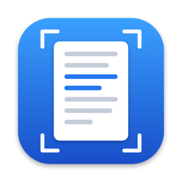

<p align="center">
  
</p>

<h1 align="center">Photo OCR</h1>

<p align="center">
  A small Mac app that pulls the printed text out of a photo.<br>
  It runs entirely on your Mac using Apple's Vision framework.
</p>

<p align="center">
  <a href="https://github.com/i-am-the-terror-that-flaps-in-the-night/photo-ocr/releases/latest"><b>Download the latest release</b></a>
</p>

## What it does

- Drop a photo on the window, open one with **Open…** (⌘O), or paste one with ⌘V.
- The recognized text appears in an editable box next to the photo.
- **Copy** puts the text on the clipboard; **Save…** writes it to a `.txt` file.
- **Clean Up** (optional) repairs misread words with the macOS spell checker and removes stray marks at the ends of lines. **Undo** puts the text back.
- **Fix with AI** (optional, macOS 26 or later with Apple Intelligence turned on) corrects misread words using the language model built into macOS. It reads whole sentences, so it catches far more than Clean Up. The model runs on your Mac. The button only appears on Macs that have it.
- Reads JPEG, PNG, HEIC (straight from an iPhone) and the other image formats macOS understands.
- Photos stored sideways or upside down are handled: the app reads the photo's rotation tag.
- Small text is enlarged and read a second time, which makes low-resolution photos much more accurate.
- Lines made only of dots and symbols (borders, bullets) are left out.

It is built for printed text: book pages, letters, receipts, signs, screenshots.

## Privacy

- **No network access.** The app contains no networking code. Recognition is done by the Vision framework, Clean Up by the spell checker and Fix with AI by the on-device language model, all of which ship with macOS and run on your Mac.
- **Nothing is stored.** No history, no analytics, no accounts. Your photos are read, shown and forgotten.
- **You can check.** The whole app is four Swift files in [`Sources/`](Sources), about 900 lines.

## Install

Built for macOS 13 (Ventura) or later; see [Known limits](#known-limits) for what has been tested.

1. Download `Photo-OCR-<version>.dmg` from the [latest release](https://github.com/i-am-the-terror-that-flaps-in-the-night/photo-ocr/releases/latest).
2. Open it and drag **Photo OCR** into **Applications**.
3. Open Photo OCR. The first time, macOS will block it (see below).

### The first-launch warning

Photo OCR is **not notarized by Apple**. Notarization requires a paid Apple Developer account, which this project does not have. Because of that, macOS shows a warning the first time you open the app and refuses to start it.

To allow it:

1. Try to open Photo OCR once, and dismiss the warning.
2. Open **System Settings › Privacy & Security**.
3. Scroll down to the message about Photo OCR and click **Open Anyway**.

You only need to do this once.

If you would rather not trust a downloaded binary, [build it yourself](#build-from-source). An app you compile on your own Mac does not trigger the warning.

### Verify the download

Each release lists the SHA-256 checksum of the disk image. To check your download:

```bash
shasum -a 256 ~/Downloads/Photo-OCR-*.dmg
```

The output should match the checksum in the release notes and in the `.sha256` file attached to the release.

## Build from source

You need the Xcode Command Line Tools (`xcode-select --install`). Xcode itself is not required, and there are no third-party dependencies.

```bash
git clone https://github.com/i-am-the-terror-that-flaps-in-the-night/photo-ocr.git
cd photo-ocr
./build.sh
open build/PhotoOCR.app
```

Other scripts:

| Command | What it does |
| --- | --- |
| `./Tests/run.sh` | Runs the OCR core against the sample images in `Tests/fixtures`. |
| `./scripts/make_dmg.sh` | Packages the built app into `dist/Photo-OCR-<version>.dmg`. |
| `./scripts/make_art.sh` | Regenerates the app icon and the disk image background. |

## How it is put together

| File | Role |
| --- | --- |
| [`Sources/OCRCore.swift`](Sources/OCRCore.swift) | Loads an image, reads its rotation tag and runs `VNRecognizeTextRequest`. No UI code. |
| [`Sources/TextCleanup.swift`](Sources/TextCleanup.swift) | The optional Clean Up step: cautious word repair and stray-mark removal. |
| [`Sources/AITextFixer.swift`](Sources/AITextFixer.swift) | The optional Fix with AI step, using Apple's on-device Foundation Models framework. |
| [`Sources/PhotoOCRApp.swift`](Sources/PhotoOCRApp.swift) | The SwiftUI window: drop, open, paste, copy and save. |
| [`Tests/ocr_cli.swift`](Tests/ocr_cli.swift) | A command-line wrapper around the OCR core, used by the tests. |
| [`build.sh`](build.sh) | Compiles a universal app with `swiftc` and signs it ad hoc. |

## Known limits

- **Handwriting and handwriting-style fonts** are hit and miss. The app is meant for ordinary printed text.
- **Layout is not preserved.** You get the lines of text in reading order, not tables or columns as such.
- **Steep angles, blur and glare** reduce accuracy. A photo taken roughly square-on in good light works best.
- **macOS versions:** the app targets macOS 13 and later, but it has only been run on macOS 27. Older versions are untested.
- **Intel Macs:** the app is a universal build, but it has only been run on Apple Silicon and, for the Intel half, under Rosetta. It has not been tried on a real Intel Mac.
- **Language:** recognition uses Vision's default language setting.
- **Fix with AI can change more than it should.** It is a language model: it usually only repairs misread words, but it can reword a phrase, drop a fragment or "correct" an unusual name. It joins the lines of a paragraph. Compare against the photo for anything that matters, and use Undo if you don't like the result.
- **Clean Up is English only and not perfect.** It only replaces a word when the fix is close to unambiguous, so some misreads stay, and now and then it picks the wrong real word. Check names and numbers yourself.

## License

[Apache License 2.0](LICENSE).
